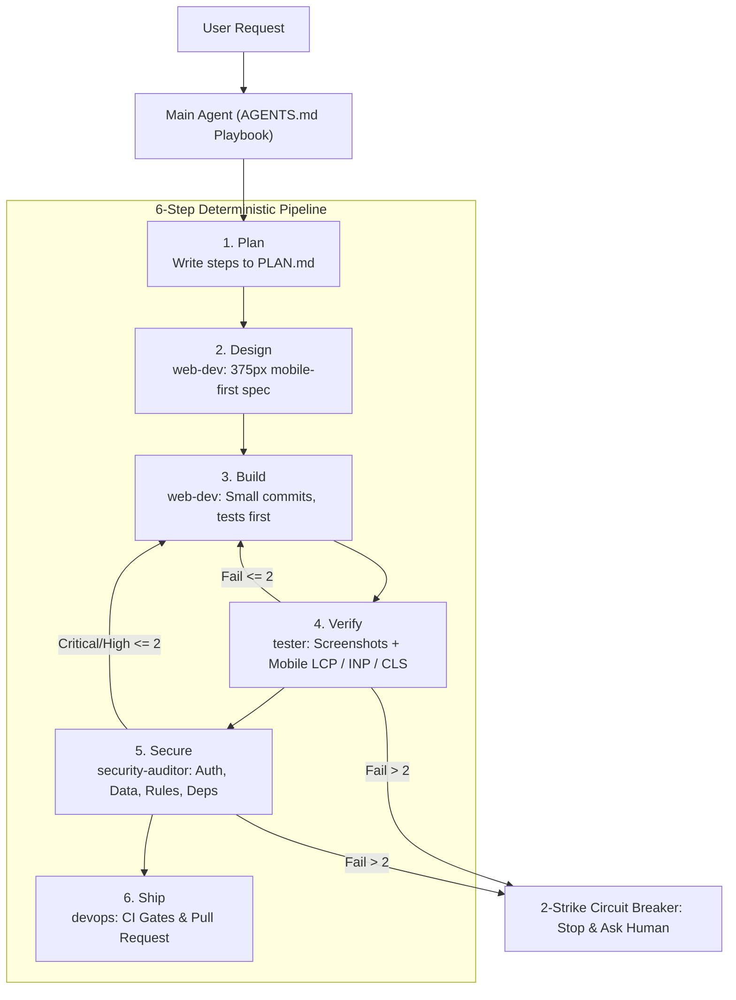

# webdev-multi-agent

> A deterministic **Multi-Agent Playbook, Sub-Agent Roster, and Skills Kit** for Web Developers — structured around a proof-driven 6-step pipeline (`Plan → Design → Build → Verify → Secure → Ship`).

Designed to be written **once** in `AGENTS.md` and `.agents/` so it works seamlessly across **Antigravity**, **Claude Code**, **Codex**, **Gemini CLI**, and **Cursor**.

---

## Architecture



### Core Guardrails
- **Small Context, Specialized Execution**: Each sub-agent loads only its own skills and explicit least-privilege `tools:`.
- **Proof-Driven Handoffs**: No step completes until the owning sub-agent returns verifiable evidence (plan, design spec, green tests/build, screenshots + Core Web Vitals, audit report, CI status).
- **Never Skip a Step**: Every non-trivial task follows the same deterministic path.
- **2-Strike Circuit Breaker**: If any sub-agent fails the same step twice, automation halts and asks the user for direction.

---

## Sub-Agents & Skills Roster

| Sub-Agent | Pipeline Ownership | Assigned Skills | Tool Access |
| :--- | :--- | :--- | :--- |
| **`web-dev`** | Step 2 (Design), Step 3 (Build) | `frontend-ui-engineering`, `impeccable`, `incremental-implementation` | Read/Write/Edit, Shell, MCP (`StitchMCP`) |
| **`tester`** | Step 4 (Verify) | `tdd`, `browser-testing-with-devtools` | Read/Write/Edit, Shell, MCP (`chrome-devtools-mcp`) |
| **`security-auditor`** | Step 5 (Secure) | `security-and-hardening`, `firebase-security-rules-auditor` | **Read-only** (`read_file`, `run_command` for audits) |
| **`devops`** | Step 6 (Ship) | `ci-cd-and-automation`, `shipping-and-launch` | Read/Write/Edit, Shell |

---

## Repository Structure

```text
webdev-multi-agent/
├── AGENTS.md                        # Main Agent Orchestrator Playbook (single source of truth)
├── CLAUDE.md                        # Cross-tool bridge (@AGENTS.md for Claude Code)
├── PLAN.md                          # Active task execution plan & proof tracker
├── .github/
│   └── workflows/
│       └── ci.yml                   # Automated CI quality gates (secrets, lint, test, build)
├── .agents/
│   ├── agents/                      # Sub-agent definitions with explicit tool permissions
│   │   ├── web-dev.md
│   │   ├── tester.md
│   │   ├── security-auditor.md
│   │   └── devops.md
│   └── skills/                      # 9 modular skills (Progressive Disclosure SKILL.md)
│       ├── frontend-ui-engineering/
│       ├── impeccable/
│       ├── incremental-implementation/
│       ├── browser-testing-with-devtools/
│       ├── tdd/
│       ├── security-and-hardening/
│       ├── firebase-security-rules-auditor/
│       ├── ci-cd-and-automation/
│       └── shipping-and-launch/
└── demo-app/                        # "Sprint Pulse" — End-to-End verified 375px demo app
    ├── DESIGN_SPEC.md               # 375px mobile-first design spec & WCAG AA contrast table
    ├── firestore.rules              # Least-privilege reference Firestore Security Rules
    ├── src/                         # Zero-dependency ES modules UI & domain model
    ├── tests/                       # 25 unit & storage recovery tests (node:test)
    └── scripts/                     # Linter, builder, and hardened localhost dev server
```

---

## Cross-Tool Compatibility

| Tool | Main Rules | Sub-Agents | Skills |
| :--- | :--- | :--- | :--- |
| **Antigravity** | `AGENTS.md` | `.agents/agents/*.md` | `.agents/skills/<name>/` |
| **Claude Code** | `CLAUDE.md` (`@AGENTS.md`) | `.claude/agents/*.md` (optional mirror) | `.claude/skills/<name>/` |
| **Codex** | `AGENTS.md` | `.codex/agents/*.toml` | `.agents/skills/<name>/` |
| **Gemini CLI** | `GEMINI.md` / `AGENTS.md` | `.gemini/agents/*.md` | `.agents/skills/<name>/` |
| **Cursor** | `AGENTS.md` | `.cursor/agents/*.md` | `.agents/skills/<name>/` |

---

## Working Example: Sprint Pulse (`demo-app/`)

`demo-app/` contains **Sprint Pulse**, a zero-dependency, offline-first `375px` mobile-first task tracker built end-to-end by this multi-agent pipeline (requires **Node.js >= 22**):

```bash
cd demo-app
npm run lint    # Syntax & unsafe DOM sink checks
npm test        # 25/25 unit & corrupted-storage recovery tests (node:test)
npm run build   # Builds static assets into demo-app/dist/
npm start       # Serves http://127.0.0.1:4173 with strict CSP & security headers
```

### Verified End-to-End Dry Run Metrics
- **Automated Tests**: `25 / 25` passing across `5` suites (`node:test`)
- **Mobile Core Web Vitals (`375x812`, Chrome DevTools MCP)**: `LCP 123ms` · `INP 21ms` · `CLS 0.00`
- **Mobile Ergonomics**: `0px` horizontal overflow (`375 <= 375`) · `15/15` touch targets `>= 44x44px`
- **Security Audit**: `0` Critical / High / Medium findings · Least-privilege `firestore.rules` `PASS`

---

## Using This Repo as a Starter Kit

1. Clone or use this repository as a template for your web project.
2. Customize **Tooling Defaults** in `AGENTS.md` and stack-specific checks in `.agents/skills/` (e.g., swap `firebase-security-rules-auditor` for Supabase RLS or SQL policy checks if needed).
3. Remove `demo-app/` once you are ready to scaffold your own app, and keep `.github/workflows/ci.yml` aligned with your project's lint/test/build scripts.
