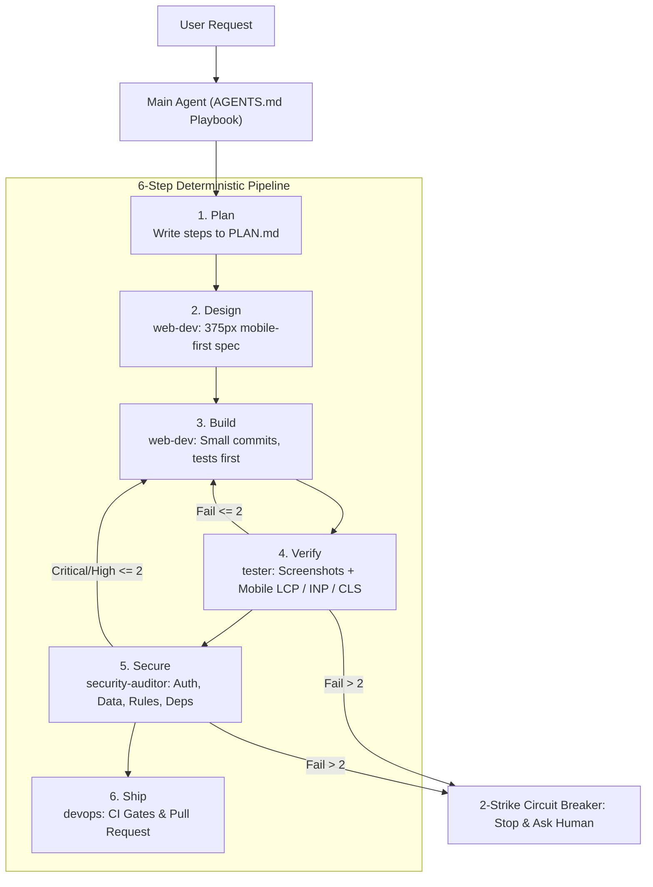

# webdev-multi-agent

> A deterministic **Multi-Agent Playbook, Sub-Agent Roster, and Skills Kit** for Web Developers — structured around a proof-driven 6-step pipeline (`Plan → Design → Build → Verify → Secure → Ship`).

Designed to be written **once** in `AGENTS.md` and `.agents/` so it works seamlessly across **Antigravity**, **Claude Code**, **Codex**, **Gemini CLI**, and **Cursor**.

---

## Architecture



### Core Guardrails
- **Small Context, Specialized Execution**: Each sub-agent loads only its own skills and explicit least-privilege `tools:`.
- **Proof-Driven Handoffs**: No step completes until the owning sub-agent returns verifiable evidence (plan, design spec, green tests/build, screenshots + Core Web Vitals, audit report, CI status).
- **Never Skip a Step**: Every non-trivial task follows the same deterministic path.
- **2-Strike Circuit Breaker**: If any sub-agent fails the same step twice, automation halts and asks the user for direction.

---

## Sub-Agents & Skills Roster

| Sub-Agent | Pipeline Ownership | Assigned Skills | Tool Access |
| :--- | :--- | :--- | :--- |
| **`web-dev`** | Step 2 (Design), Step 3 (Build) | `frontend-ui-engineering`, `impeccable`, `incremental-implementation` | Read/Write/Edit, Shell, MCP (`StitchMCP`) |
| **`tester`** | Step 4 (Verify) | `tdd`, `browser-testing-with-devtools` | Read/Write/Edit, Shell, MCP (`chrome-devtools-mcp`) |
| **`security-auditor`** | Step 5 (Secure) | `security-and-hardening`, `firebase-security-rules-auditor` | **Read-only** (`read_file`, `run_command` for audits + post-audit `git status --porcelain` guard) |
| **`devops`** | Step 6 (Ship) | `ci-cd-and-automation`, `shipping-and-launch` | Read/Write/Edit, Shell |

> **Note:** Antigravity automatically injects MCP tools (`call_mcp_tool`, `list_resources`, `read_resource`) at runtime — do not list them manually in `.agents/agents/*.md` `tools:` frontmatter.

---

## Repository Structure

```text
webdev-multi-agent/
├── AGENTS.md                        # Main Agent Orchestrator Playbook (single source of truth)
├── CLAUDE.md                        # Cross-tool bridge (@AGENTS.md for Claude Code)
├── GEMINI.md                        # Cross-tool bridge (@AGENTS.md for Gemini CLI)
├── CUSTOMIZING.md                   # Guide for adapting skills, sub-agents, CI & hosting to your stack
├── LICENSE                          # MIT License
├── PLAN.md                          # Clean blank task execution plan template
├── package.json                     # Zero-dependency root scripts (validate, test, sync, template:init)
├── .nvmrc                           # Node.js 22 LTS version pin
├── .github/
│   ├── PULL_REQUEST_TEMPLATE.md     # Proof-driven PR checklist aligned with AGENTS.md
│   ├── dependabot.yml               # Monthly GitHub Actions version updates
│   └── workflows/
│       └── ci.yml                   # Playbook validation, sync tests, secret checks & conditional app gates
├── scripts/
│   ├── validate-agents.mjs          # Zero-dependency .agents/, tool allowlist & markdown link validator
│   ├── validate-agents.test.mjs     # Unit tests for agent/skill validation (node:test)
│   ├── sync-tools.mjs               # Mirror .agents/ to Claude, Cursor, Gemini, or Codex (--clean / --check)
│   ├── sync-tools.test.mjs          # Unit tests for cross-tool sync (node:test)
│   ├── init-template.mjs            # 1-command starter-kit initializer (removes demo-app/, strips demo:* & resets PLAN.md)
│   └── init-template.test.mjs       # Unit tests for template initialization (node:test)
├── .agents/
│   ├── agents/                      # Sub-agent definitions with explicit tool permissions
│   │   ├── web-dev.md
│   │   ├── tester.md
│   │   ├── security-auditor.md
│   │   └── devops.md
│   └── skills/                      # 9 modular skills (Progressive Disclosure SKILL.md)
│       ├── frontend-ui-engineering/
│       │   └── references/responsive-and-a11y-checklist.md
│       ├── impeccable/
│       ├── incremental-implementation/
│       ├── browser-testing-with-devtools/
│       │   └── references/devtools-recipes.md
│       ├── tdd/
│       ├── security-and-hardening/
│       │   └── references/owasp-web-checklist.md
│       ├── firebase-security-rules-auditor/
│       │   └── references/db-policy-patterns.md
│       ├── ci-cd-and-automation/
│       └── shipping-and-launch/
│           └── references/hosting-configs.md
└── demo-app/                        # "Sprint Pulse" — End-to-End verified 375px demo app
    ├── DESIGN_SPEC.md               # 375px mobile-first design spec & WCAG AA contrast table
    ├── PLAN.example.md              # Completed example PLAN.md from the Sprint Pulse run
    ├── firestore.rules              # Least-privilege reference Firestore Security Rules
    ├── src/                         # Zero-dependency ES modules UI & domain model
    ├── tests/                       # 40 unit & server security tests (node:test)
    └── scripts/                     # Linter, builder, and hardened localhost dev server
```

---

## Cross-Tool Compatibility

| Tool | Main Rules | Sub-Agents | Skills |
| :--- | :--- | :--- | :--- |
| **Antigravity** | `AGENTS.md` | `.agents/agents/*.md` | `.agents/skills/<name>/` |
| **Claude Code** | `CLAUDE.md` (`@AGENTS.md`) | `.claude/agents/*.md` | `.claude/skills/<name>/` |
| **Codex** | `AGENTS.md` | `.codex/agents/*.toml` | `.agents/skills/<name>/` |
| **Gemini CLI** | `GEMINI.md` (`@AGENTS.md`) | `.gemini/agents/*.md` | `.gemini/skills/<name>/` |
| **Cursor** | `AGENTS.md + .cursor/rules/orchestrator.mdc` | `.cursor/agents/*.md` | `.cursor/skills/<name>/` |

Mirror `.agents/` to your preferred tool in one command (automatically maps `read_file -> Read, Glob, Grep` for Claude Code, prunes stale mirrored files with `--clean`, and verifies zero drift with `--check`):

```bash
npm run sync:dry-run                              # Preview sync across all targets
node scripts/sync-tools.mjs --target=claude --clean  # Supports: claude | cursor | gemini | codex | all
npm run sync:check                                # Verify mirrored files have zero drift on disk
```

---

## Validate Playbook & Skills

Run the zero-dependency root validator and test suites anytime you modify `AGENTS.md`, sub-agents, or skills (requires **Node.js >= 22**):

```bash
npm run validate       # Validates AGENTS.md, sub-agent tool allowlists, skills & relative markdown links
npm test               # Runs all root unit tests (validator, cross-tool sync & template initializer)
npm run sync:dry-run   # Dry-runs cross-tool mirroring across Claude, Cursor, Gemini & Codex
```

---

## Working Example: Sprint Pulse (`demo-app/`)

`demo-app/` contains **Sprint Pulse**, a zero-dependency, offline-first `375px` mobile-first task tracker built end-to-end by this multi-agent pipeline (requires **Node.js >= 22**):

```bash
cd demo-app
npm run lint    # Syntax & unsafe DOM sink checks
npm test        # 40 tests (8 suites): domain model, storage recovery & hardened server checks
npm run build   # Builds static assets into demo-app/dist/
npm start       # Serves http://127.0.0.1:4173 with strict CSP & security headers
```

### Verified End-to-End Dry Run Metrics
- **Automated Tests**: `40` tests across `8` suites (`node:test`) covering domain validation, storage recovery, and static server traversal/CSP security
- **Mobile Core Web Vitals (`375x812`, Chrome DevTools MCP)**: `LCP 123ms` · `INP 21ms` · `CLS 0.00`
- **Mobile Ergonomics**: `0px` horizontal overflow (`375 <= 375`) · `15/15` touch targets `>= 44x44px`
- **Security Audit**: `0` Critical / High / Medium findings · Least-privilege `firestore.rules` `PASS`

---

## Using This Repo as a Starter Kit

1. Click **Use this template** on GitHub (or clone) to start your web project — `PLAN.md` is already reset as a clean blank template (see `demo-app/PLAN.example.md` for a completed example).
2. Follow [CUSTOMIZING.md](./CUSTOMIZING.md) to tailor **Tooling Defaults** in `AGENTS.md`, stack-specific checks in `.agents/skills/` (e.g., Next.js/Vite/Astro, Supabase RLS, or hosting headers), and custom sub-agents.
3. Run `npm run template:init` (preview first with `npm run template:init:dry-run`) once you are ready to scaffold your own app — it removes `demo-app/`, strips `demo:*` scripts from `package.json`, resets `PLAN.md` to a clean blank template, and re-validates `.agents/`, while `.github/workflows/ci.yml` automatically skips the demo-app job on every PR.
